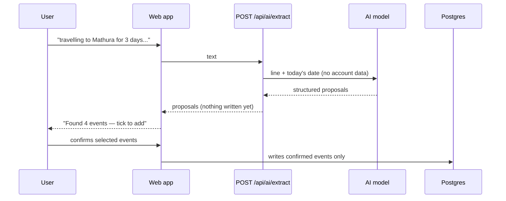

Cue's capture box is powered by deterministic parsers that run instantly, work offline, cost nothing, and can show you exactly which words produced which field. AI is optional and off by default — most input never reaches a model at all. This page explains when AI is used, how the two integration points work (Cue's own real-time assistant and the per-org BYOK paragraph extractor), and how to configure each one.

## Default: no AI

When neither `ANTHROPIC_API_KEY` nor any per-org AI provider is configured, Cue uses only its rule-based parsers. These handle the vast majority of input:

- Weekdays, `tomorrow`, `today`, `in 3 days`, `next week`, dates like `25 dec`, `5/9`
- 12- and 24-hour clocks, parts of the day, duration phrases like `for 45 min`
- Repeating plans, trips, expenses, bills, parcels, and more
- Hinglish and Hindi time words (`kal`, `parso`, `subah`, `shaam ko`, `baje`)

The rule-based parsers return `null` on anything they do not recognise rather than guessing. That means a wrong reading is visible before it is saved, not discovered next week.

---

## When AI is used

AI is only invoked when the rule-based parsers return an **uncertain reading** — either the parser cannot place what the line is for, or a Hindi/Hinglish word is left unread in the title after the time has been extracted.

`dentist friday 6pm` never touches a model. A multi-event paragraph like:

> travelling to Mathura for 3 days training initial 2 days first and second for awareness session and third september for internal committee capacity building

…genuinely needs a language model. That is four separate events with a month named once that applies to all of them. No amount of extra pattern rules will read that correctly.

There are two separate AI integration points in Cue:

<CardGroup cols={2}>
  <Card title="Capture assistant (server-wide)" icon="bolt">
    Cue's own `ANTHROPIC_API_KEY`. Reads short ambiguous lines in real time while the user types. Operators bring their own key; users see the benefit automatically.
  </Card>
  <Card title="Paragraph extractor (per-org BYOK)" icon="building">
    `POST /api/ai/extract`. Each org brings its own provider key (Anthropic or Ollama). Used for full multi-event paragraphs. Off until the org owner configures it.
  </Card>
</CardGroup>

---

## The capture assistant (`ANTHROPIC_API_KEY`)

When `ANTHROPIC_API_KEY` is set in `.env`, Cue reads short lines that its rules are unsure of — lines where the parser returns a result but is not confident — and turns a vague guess into a clarifying question instead.

**Example:** typing `doctor` would otherwise produce a guess. With the capture assistant enabled, a short pause triggers a Claude call that sends only the line and today's date. Instead of silently guessing, the box asks: *"A doctor's appointment? When?"*

**What is sent:** only the ambiguous line and today's date. No names, no contact data, no account information.

**Daily limit:** `CAPTURE_AI_DAILY_LIMIT` (default 40 readings per person per day) acts as a per-account cost ceiling.

<ParamField path="ANTHROPIC_API_KEY" type="string">
  Cue's own Anthropic key for the real-time capture assistant. This is an operator-level key — set it in `.env` and every user on the deployment benefits. Leave blank to disable; the deterministic parsers continue to work without it.
</ParamField>

<ParamField path="CAPTURE_AI_MODEL" type="string" default="claude-haiku-5-5">
  The Anthropic model used for the real-time capture assistant.
</ParamField>

<ParamField path="CAPTURE_AI_DAILY_LIMIT" type="number" default="40">
  The maximum number of AI readings per person per day. A ceiling on what one account can cost.
</ParamField>

---

## Per-org paragraph extraction (BYOK)

The multi-event paragraph extractor (`POST /api/ai/extract`) uses a provider key that lives on the **org**, not the server. One credential, one bill, shared by all members of that org.

### Provider options

| Provider | Setup | Cost | Privacy |
|---|---|---|---|
| `none` (default) | Nothing — parsers only | Free | All local |
| `anthropic` | Org pastes its own Anthropic API key in Settings | ~₹0.15 per long sentence, billed to the org | Line + date sent to Anthropic |
| `ollama` | Org provides an endpoint URL for a local model | Free | Nothing leaves the machine |

### Who can configure it

Only **org owners** can change the AI provider, store a key, list local Ollama models, or run a test call. Members see one line — *"Switched on by your account owner"* — and no controls. This is intentional: a disabled form someone cannot submit is worse than no form at all.

The role is checked on every request, never from the JWT token. A role change takes effect on the next API call, not at the next token refresh.

### How keys are stored

<Warning>
  **`ENCRYPTION_KEY` is required to use the BYOK feature.** Without it, the server refuses to store a provider key rather than falling back to plain text. The stored key is encrypted at rest with AES-256-GCM, keyed off `ENCRYPTION_KEY` via `src/secrets.ts`.
</Warning>

The API **never returns a stored key** — only a masked hint (e.g. `sk-ant-…a1b2`) is sent back to the browser. A database dump does not expose the full key.

<ParamField path="ENCRYPTION_KEY" type="string">
  Required for BYOK AI key storage. Also required for Google and Microsoft OAuth tokens. See [Environment Variables](/configuration/environment#encryption--ai) for how to generate it.
</ParamField>

<ParamField path="AI_DEFAULT_MODEL" type="string" default="claude-haiku-5-5">
  The Anthropic model used when an org configures the `anthropic` provider. Applied to the `POST /api/ai/extract` endpoint.
</ParamField>

---

## How extraction works

`POST /api/ai/extract` returns **proposals**, not saved entries. Nothing is written to the database until the user reviews the extracted events and taps to confirm each one. A misread date costs a rejected suggestion, never a wrong entry in a real calendar.



Anything the model returns that would not survive saving — an unparseable date, an empty title, an unknown kind — is dropped before it reaches the user. Extracted events are saved with `allowConflict` because sessions inside a trip are meant to coexist.

---

## Setting up Ollama

Ollama runs models locally so nothing leaves your machine. To use it:

<Steps>
  <Step title="Install and start Ollama">
    Follow the [Ollama installation guide](https://ollama.com). Start it with `ollama serve`. By default it listens on `http://localhost:11434`.
  </Step>
  <Step title="Pull a model">
    ```bash
    ollama pull llama3
    ```
  </Step>
  <Step title="Configure the org in Cue settings">
    Sign in as an org owner, go to **Settings → AI**, choose **Ollama** as the provider, and enter the endpoint URL (e.g. `http://localhost:11434`). Use **List models** to pick the model you pulled, then **Test** to verify.
  </Step>
</Steps>

<Tip>
  Ollama is ideal for self-hosted deployments where data privacy is a priority. The model runs entirely on your server hardware — no API keys, no billing, no data leaving the machine.
</Tip>

---

## Summary of configuration variables

<ParamField path="ANTHROPIC_API_KEY" type="string">
  Operator's Anthropic key for the real-time capture assistant. Leave blank to disable; parsers work without it.
</ParamField>

<ParamField path="CAPTURE_AI_MODEL" type="string" default="claude-haiku-5-5">
  Model for the real-time capture assistant.
</ParamField>

<ParamField path="CAPTURE_AI_DAILY_LIMIT" type="number" default="40">
  AI readings per person per day (capture assistant).
</ParamField>

<ParamField path="AI_DEFAULT_MODEL" type="string" default="claude-haiku-5-5">
  Model used for per-org paragraph extraction when the `anthropic` provider is configured.
</ParamField>

<ParamField path="ENCRYPTION_KEY" type="string">
  Required to store per-org AI provider keys at rest. AES-256-GCM. Also required for calendar OAuth tokens.
</ParamField>
